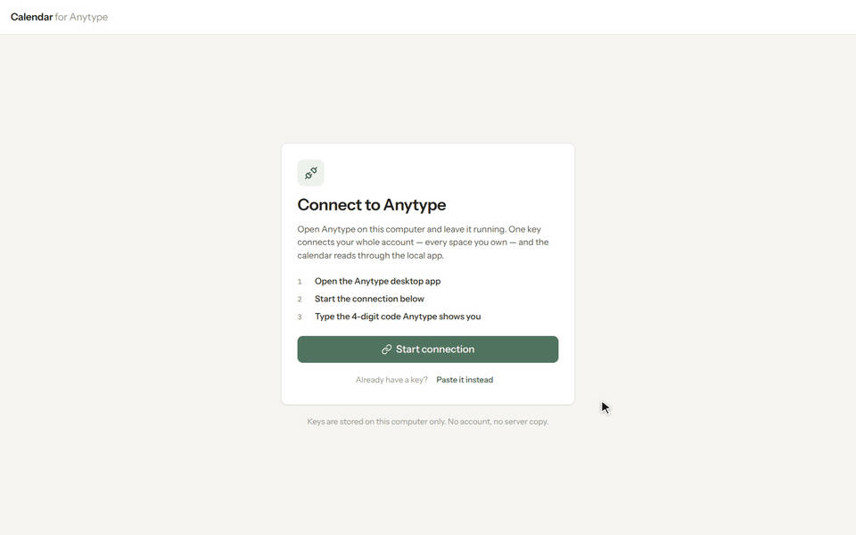

<div align="center">


# Calendar for Anytype

[](https://github.com/ablunier/anytype-calendar/actions/workflows/ci.yml)
[](https://github.com/ablunier/anytype-calendar/releases)

[](LICENSE)

A desktop calendar for your [Anytype](https://anytype.io) objects. It runs on your machine
and talks only to your local Anytype.

[Features](#features) • [Install](#install) • [Getting started](#getting-started) • [Development](#development) • [Architecture](#architecture)



</div>

Calendar for Anytype reads objects from your Anytype account through the local API and
places every object that has a date on a month, week or day view. A `Task` with a due date,
a `Meeting` with a start and an end, and a `Note` with a creation date all show up in one
place. Your data stays in Anytype and is never copied anywhere else.

> [!NOTE]
> The app is in **beta** (`1.0.0-beta.2`). It uses Anytype's pre-release local API v2, so
> it needs an Anytype desktop release recent enough to serve that API.

## Features

- **Your Anytype on a calendar.** Choose which spaces, object types and queries (Anytype
  "sets") to show, and which date property of each type places it on the grid. A type with
  both a start and an end property is drawn as one bar across the days it covers.
- **Month, week and day views.** Objects with a time sit on the hour grid. Dates without a
  time show as all-day. Times use your computer's time zone.
- **Editing**, with a read/write key: drag an object to move it, double-click a day or an
  hour to create one, and tick it done or change its dates from the detail panel.
- **Colours from Anytype.** An object takes its type's colour, or the colour of the option
  chosen in a select property you pick.
- **A detail panel you configure.** Choose which properties the panel shows, in which
  order, and which checkbox and text properties act as Done and Location. The panel also
  opens the object in Anytype.
- **Subscribed calendars.** Add any iCalendar (`.ics` or `webcal://`) address, such as
  Google's secret iCal address or an Outlook published link. Its events appear read-only
  next to your Anytype objects, including repeating ones.
- **Private by default.** The API key and the feed addresses are encrypted with your OS
  keychain. You decide in Anytype which spaces the key can reach and whether it can write.
- **Preferences:** light and dark themes, default view, first day of the week, ISO week
  numbers, 12- or 24-hour time, and English, Spanish or Galician.

## Install

Download the installer for your platform from the
[latest release](https://github.com/ablunier/anytype-calendar/releases): `.deb` for Linux,
`Setup.exe` for Windows, and `.dmg` or `.zip` for macOS.

> [!WARNING]
> The builds are not code-signed.
>
> - **Windows**: SmartScreen warns on first run. Choose _More info_ → _Run anyway_.
> - **macOS**: the app is blocked the first time you open it. Allow it under _System
>   Settings_ → _Privacy & Security_ → _Open Anyway_.

Windows builds update themselves. On macOS and Linux, the app tells you when a newer release
is out and links to its download page.

## Getting started

1. Open Anytype desktop and keep it running.
2. Open Calendar for Anytype and start the connection. Anytype shows a 4-digit code: type
   it into the app. If you already have an API key (from Anytype's _Settings_ → _API Keys_),
   you can paste it instead.
3. Pick the spaces, types and queries to show, and the From/To date property of each type.
4. Your calendar opens. You can change any of these choices later in Settings.

> [!TIP]
> The local API cannot revoke a key. Signing out deletes the key from this computer. To
> revoke it, delete it in Anytype under _Settings_ → _API Keys_.

## Development

### Prerequisites

- [Node.js](https://nodejs.org) ≥ 26.8.1 and npm ≥ 12.0.2. Both are pinned with
  [Volta](https://volta.sh) in `package.json`, and Volta picks them up automatically.
- Anytype desktop, if you want to sign in against real data. You can also run against a
  simulated Anytype instead (see below).

### Run the app

```sh
npm install
env -u ELECTRON_RUN_AS_NODE npm run dev
```

`npm install` also downloads the Electron binary and installs the isolated architecture-lint
toolchain.

> [!IMPORTANT]
> Keep the `env -u ELECTRON_RUN_AS_NODE` prefix. Some editors and terminals set that
> variable. When it is set, Electron starts in plain Node mode and `npm run dev` fails with a
> misleading `TypeError` about `isPackaged`.

To work without Anytype, sign in against a simulated one:

```sh
env -u ELECTRON_RUN_AS_NODE ANYTYPE_CALENDAR_FAKE_AUTH=1 npm run dev
```

The sign-in code is always `2749`. You can also paste the API key `ak_fake_2749`. The fake
Anytype provides four sample spaces and a sample month of objects. Subscribed calendars
return a sample feed. Edits last only until you quit, and nothing touches a real Anytype.

### Scripts

Run these from the repo root:

| Command                    | What it does                                                                          |
| -------------------------- | ------------------------------------------------------------------------------------- |
| `npm run dev`              | Start electron-vite and Electron with hot module reload                               |
| `npm test`                 | Run Vitest: domain, application, infrastructure, renderer, components and main tests  |
| `npm run typecheck`        | Typecheck the whole monorepo                                                          |
| `npm run lint`             | Check formatting and lint rules with Biome (`lint:fix` fixes them)                    |
| `npm run lint:arch`        | Check the layering rules with dependency-cruiser                                      |
| `npm run build`            | Build every package, then the desktop app                                             |
| `npm run package` / `make` | Package the app, or build its installers, for the current OS into `apps/desktop/dist` |
| `npm run clean`            | Remove build output                                                                   |

CI runs `lint`, `typecheck`, `test` and `lint:arch` on every pull request. To run a single
test file, use `npx vitest run path/to/file.test.ts`. To run one layer, use
`npx vitest run --project domain`.

> [!NOTE]
> Before you bump `electron`, `vite` or `@vitejs/plugin-react`, read
> [docs/deps-notes.md](docs/deps-notes.md). Several version pins are load-bearing.

### Releasing

Bump `version` in `apps/desktop/package.json` and commit it. Then push a matching tag:

```sh
git tag v1.2.3 && git push origin v1.2.3
```

The `Release` workflow builds the installers for all three platforms and publishes a GitHub
release. See [docs/releasing.md](docs/releasing.md) for the details and the update checks.

## Architecture

The project is an npm workspaces monorepo: an Electron and React app, plus one package for
each bounded context, each split into hexagonal layers.

```
apps/desktop         Electron main process (the composition root), preload, and the React renderer
packages/auth        Signing in, and keeping the API key
packages/schema      Dated types and queries, and which of them go on the calendar
packages/events      Objects in the span on screen, and edits to them
packages/feeds       Subscribed iCalendar feeds
packages/kernel      Shared use-case plumbing
tools/arch-lint      Isolated dependency-cruiser install
```

Each context is split into `domain` → `application` → `infrastructure`, and dependencies
only point inward. Contexts never import each other. The desktop app's main process wires
them together by hand. `npm run lint:arch` enforces these rules. Anytype is reached only
through [`@ablunier/anytype-client`](https://github.com/ablunier/anytype-client), a typed
client for the local API v2.

To learn more:

| Topic                                        | Doc                                          |
| -------------------------------------------- | -------------------------------------------- |
| Contexts, layers, import rules, hand wiring  | [docs/architecture.md](docs/architecture.md) |
| Main process, IPC, renderer and screens      | [docs/desktop-app.md](docs/desktop-app.md)   |
| Anytype API behaviour the adapters rely on   | [docs/anytype-api.md](docs/anytype-api.md)   |
| Release workflow and update checks           | [docs/releasing.md](docs/releasing.md)       |
| Version pins, `postinstall` and packaging    | [docs/deps-notes.md](docs/deps-notes.md)     |
| Guidance for AI coding agents                | [AGENTS.md](AGENTS.md)                       |
